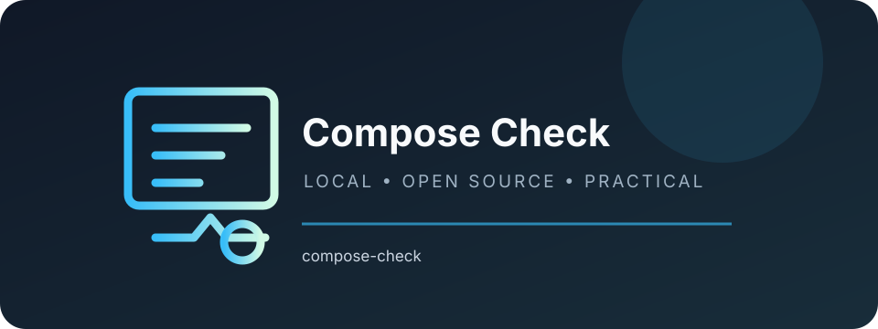

<p align="center"></p>
<p align="center"></p>
<p align="center">   </p>
<p align="center"></p>

## 🧭 Overview
Compose Check performs a small static review of a local Docker Compose file. It validates service definitions, dependency references, and obvious host-port collisions without starting containers.

## ✨ Features
- 🧩 Checks that services have an image or build configuration.
- 🔗 Finds depends_on references to missing services.
- 🚦 Detects repeated numeric host-port bindings.
- 🛡️ Reads configuration only; it never invokes Docker.

## 🎬 Demo
```text
$ python main.py compose.yaml
compose.yaml: services.api: depends_on references unknown service 'cache'
compose.yaml: host port 8080 is used by both 'web' and 'api'
2 issue(s) found.
```
This is a local example, not a hosted demo.

## 🚀 Quick Start
```bash
python -m pip install -r requirements.txt
python main.py examples/compose.yaml
```
The checker intentionally covers a practical subset of Compose syntax. It does not replace `docker compose config`.

## 🧰 Tech Stack
- Python 3.10+
- PyYAML safe loading
- unittest

## 🗂️ Folder Structure
```text
main.py
compose_check.py
tests/test_compose_check.py
examples/compose.yaml
assets/overview.svg
requirements.txt
```

## 🗺️ Roadmap
- [x] Core local workflow
- [x] Documented command-line or browser interface
- [ ] Broader edge-case coverage
- [ ] Optional CI examples

## 🤝 Contributing
Issues and focused pull requests are welcome. Add regression tests for bug fixes and document new options.

## 📄 License
Released under the [MIT License](LICENSE).

<p align="center"></p>
